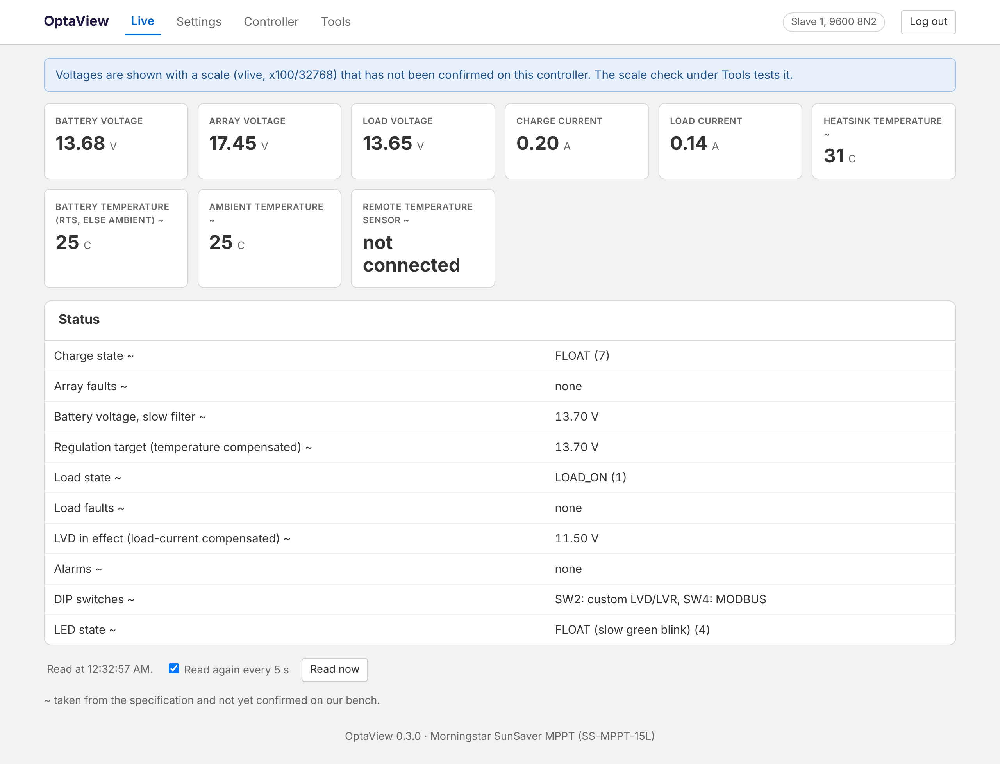
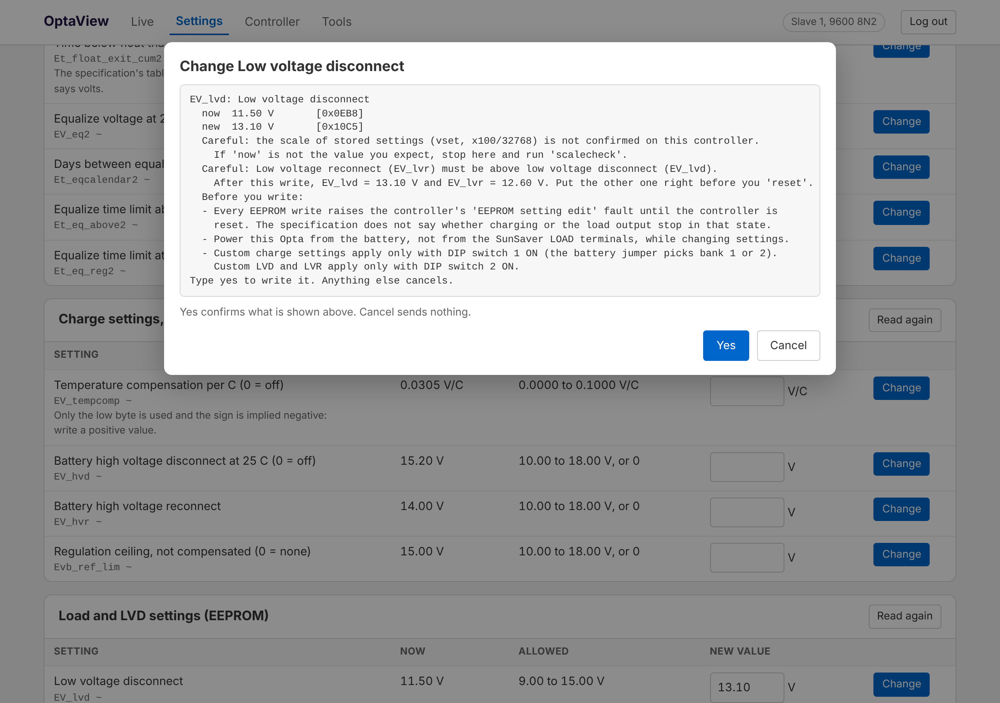
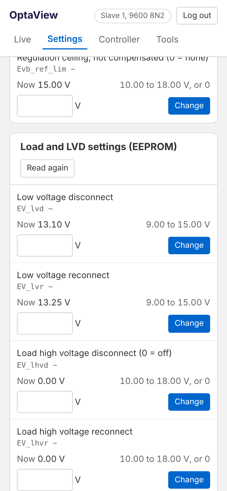

# OptaView

OptaView turns an Arduino Opta into a field tool for Morningstar charge controllers: an open
replacement for the Windows-only MSView. It talks Modbus RTU over the Opta's RS-485 port to a
SunSaver MPPT through an MRC-1 adapter. You drive it from a web page that the Opta serves on
its Ethernet port, or from any serial terminal over USB.

**Version 0.3** can find the controller, show its meters and status, list every documented
register, save a snapshot of all of them, and change stored settings such as the low voltage
disconnect, with a check before and a read-back after each write. New in 0.3 is
[the web page](#the-web-page), which does all of that from a browser.



> **Status.** Version 0.2 rewrote the June 2026 demo and 0.3 adds the web page. The logic is
> tested on a PC against a simulated SunSaver, the page is driven in a real browser against
> that simulation, and the sketch is built in CI (see [Tests](#tests)).
> **OptaView has not been run on an Opta yet: not against a real controller, and its network
> side not on a real Ethernet port.** The section
> [What is confirmed on hardware](#what-is-confirmed-on-hardware) lists what that leaves open,
> and [First session](#first-session) starts with steps that only read.

## What you need

- An Arduino Opta with RS-485 (Opta RS485 or Opta WiFi).
- A Morningstar MRC-1 MeterBus adapter between the Opta and the SunSaver MPPT.
- For the web page: an Ethernet cable from the Opta to your network, or straight to a laptop.
- Libraries: **ArduinoRS485** and **ArduinoJson** (version 7). The Ethernet library comes with
  the Opta's board package.

### Wiring

| Arduino Opta | MRC-1 | |
|---|---|---|
| A | terminal **B** | crossed on purpose: Morningstar's A is the inverting line, the Opta's A is not |
| B | terminal **A** | |
| GND | terminal G | |

Before suspecting the wiring, check that the MRC-1 power switch is ON (its LED is solid green
either way), that the RJ-11 cable is fully seated at both ends, and that the SunSaver's DIP
switch 4 selects MODBUS instead of MeterBus. The link is 9600 baud, 8N2, slave 1.

The console repeats this with the `wires` command, and `probe` prints it when nothing answers.

## Build and upload

```powershell
arduino-cli lib install ArduinoRS485 ArduinoJson
arduino-cli compile --upload -p COM4 --fqbn arduino:mbed_opta:opta:security=sien OptaView\OptaView.ino
```

`security=sien` builds the signed image that the project's Optas need. An Opta with the stock
bootloader takes the plain `arduino:mbed_opta:opta`.

Open the serial monitor at **115200 baud** and set the line ending to **New Line**. OptaView
greets each time a terminal opens the port. It echoes what you type, so switch local echo off in
terminal programs such as PuTTY.

A PIN for the web page and a fixed network address can be built in before you compile: see
[Network and PIN](#network-and-pin).

## The web page

Plug the Opta into the network and open `http://<its address>/` in a browser. The USB console
shows the address when a terminal opens the port, when the network changes, and with `net`:

```text
Network   address 192.168.1.57 from DHCP
Web page  http://192.168.1.57/, no PIN yet: the first visitor chooses it
```

Where no DHCP server answers, as on a cable straight to a laptop, the Opta takes
**192.168.1.16** after 20 seconds. Give the laptop an address on the same network, such as
192.168.1.20 with the mask 255.255.255.0.

The first browser that opens the page chooses a PIN of 4 to 8 digits, unless one is built in.
After that the page has four views:

| View | |
|---|---|
| **Live** | The meters and the status registers, read again every 5 seconds |
| **Settings** | Every stored setting with the value the controller holds now, the range OptaView allows and a field for a new value, under the notes to read before writing |
| **Controller** | Restart, the switches (coils), any group of registers as a table, and where the register map comes from |
| **Tools** | Find the controller, link status, the voltage scale check, a snapshot to download, the wiring checklist, and the console itself |



The page decides nothing about a change by itself. Change, Switch on and Restart send the
console's own commands (`set EV_lvd 13.10`, `coil ... on`, `reset`) and show the console's own
text in a dialog. The limits, the pair checks, the question before a write and the read-back
after it are therefore the ones under [What keeps a session safe](#what-keeps-a-session-safe).
Yes and Cancel answer the question that is on the screen and no other. Everything the page
sent is in the log of the Tools view, where the console also takes commands as you type them.

It is laid out for a phone as well:



What to know before you rely on it:

- **It is not encrypted.** The Opta has no TLS here, so the PIN and the session cross the
  network in the clear. Use the page on a network you trust and never put it on the internet.
  The PIN keeps somebody who is on that network from changing settings in passing. It is not
  more than that.
- **One browser is logged in at a time.** Logging in from a second one ends the first one's
  session. A session also ends after 30 minutes in which nobody did anything (the readings the
  page takes by itself do not count), and with `web logout` on the USB console.
- **Wrong PINs are answered more and more slowly:** the next try has to wait 1 second, then 2,
  4, 8 and 30 seconds, and up to 15 minutes. `web pin <digits>` on the USB console sets a new
  PIN and ends the wait.
- **One thing at a time.** The Opta answers one request and then the next. While a command
  runs on the USB console the page waits, and the other way round. A command from the page
  that takes longer than a minute is stopped, and so is one whose browser has gone.
- **No connection can hold the Opta up.** A request has 6 seconds to arrive. A browser that
  takes nothing of an answer for 5 seconds is taken to be gone, and an answer that is still
  not delivered after 30 seconds of sending is given up. The page is 53 KB and the Opta's
  network stack sends about 1 KB per round trip, so the page needs a link whose round trip is
  well under half a second.
- **Open it by its address.** A request that names the Opta in any other way than by its IP
  address is refused, which keeps a page from another web site from reaching the Opta through
  your browser.
- **Nothing is kept at power-off:** not a PIN chosen in the browser, not a network mode typed
  at the console. What is built in with `OptaViewConfig.h` is what the Opta starts with.
- `watch` belongs to the USB console. On the page the Live view does that job.

## Network and PIN

| Mode | |
|---|---|
| `auto` (the default) | DHCP first. When no address has arrived after 20 s, the fixed address. If the cable only goes in after that, DHCP gets one more try. An address from DHCP that is lost starts all of this again |
| `dhcp` | DHCP only, for as long as it takes |
| `static` | The fixed address at once |

While it waits for DHCP the Opta cannot tell a cable that is out from a network without DHCP.
A cable that was out for more than 20 s therefore finds the fixed address in use when it goes
back in, and DHCP gets its one more try then. (A cable that goes back in within 3 s of the
change to the fixed address looks like one that was in all along, and keeps the fixed address.)
A router that needs longer than 20 s to hand out addresses again, as after a power cut, can
leave the Opta on the fixed address, so on a network that always has DHCP use `dhcp`. Once the
fixed address is in use and the extra try is spent, a cable moved from a laptop to a network
with DHCP keeps the fixed address until `net auto` or a restart.

The fixed address is 192.168.1.16 with the mask 255.255.255.0, unless you set another. These
commands of the USB console change things until power-off:

| Command | |
|---|---|
| `net` | The address, where it came from, the mode and the Opta's hardware (MAC) address |
| `net auto`, `net dhcp` | Change the mode |
| `net static <address> [mask] [gateway]` | A fixed address, for example `net static 10.20.30.40 255.255.0.0` |
| `web` | Where the page is, whether a PIN is set and whether a browser is logged in |
| `web pin <digits>`, `web pin clear` | Set the PIN, or let the next visitor choose it |
| `web logout` | End the browser's session |

To build settings in, copy `OptaViewConfig.h.example` to `OptaViewConfig.h` next to the sketch,
take the `//` off the lines you need and upload again:

```cpp
#define OPTAVIEW_WEB_PIN "2468"
#define OPTAVIEW_NET_MODE "static"
#define OPTAVIEW_NET_ADDRESS "192.168.5.20"
```

`OptaViewConfig.h` is in `.gitignore`, so a PIN in it stays out of the repository. A value that
cannot be used (a PIN with a letter in it, an address like 192.168.1.300, a gateway on another
network) stops the build with a message that names the setting.

## First session

The first four steps only read. Nothing is written to the controller until step 6. The steps
are given as console commands. On the web page they are Find the controller under Tools (1),
the Live view (2), the register tables of the Controller view (3), Download a snapshot (4) and
the voltage scale check (5) under Tools, Change in the Settings view (6) and Restart in the
Controller view (7).

1. `probe` looks for the controller: it tries the link settings in use, then the usual
   alternatives, and reports a find only when a register was actually read.
2. `live` shows the meters and the status registers. Compare the battery voltage with a
   multimeter.
3. `dump` reads every register in the profile. Lines marked `~` come from Morningstar's
   specification and have not been seen on our bench, so look for values that make no sense.
4. `snapshot` prints every raw value as JSON. Copy it out of the terminal and keep it: it is the
   record of how the controller was set before you changed anything. Download a snapshot on the
   page saves the same JSON as a file. It saves nothing that broke off on the way, and asks
   first when some registers could not be read.
5. `scalecheck 13.42` (with your own multimeter reading) settles the voltage scales. See
   [The voltage scales](#the-voltage-scales). Do this before writing any voltage.
6. `set EV_lvr 13.25`, then `set EV_lvd 13.10`: each shows the old and the new value and waits
   for `yes`. Raising the reconnect voltage first keeps it above the disconnect voltage at
   every step.
7. `reset` restarts the controller so that it uses the new settings, waits for it to come
   back and shows the status again. `dump load` then shows what is stored. If it says that the
   controller answered all the time and was not seen to restart, the restart is still due.

While you change settings, power the Opta from the battery and not from the SunSaver's LOAD
terminals: the specification does not say whether the load output stays on between an EEPROM
write and the reset. A custom LVD and LVR only apply with DIP switch 2 ON, and custom charge
settings only with DIP switch 1 ON.

This is what a session looks like. The text comes from the simulator, until there is a capture
from the bench:

```text
optaview> probe
Looking for Morningstar SunSaver MPPT (SS-MPPT-15L).
Each try reads adc_vb_f (0x0008). Press a key to stop.
  9600 8N2, slave 1, function 4: ok
Found it: slave 1, 9600 8N2, read function 4.
Battery voltage reads 13.68 V.
Identification: vendor "Morningstar Corp.", product "SS-MPPT", version "v01.01.01"
These settings are now in use. Try 'live'.
optaview> set EV_lvr 13.25
EV_lvr: Low voltage reconnect
  now  12.60 V       [0x1021]
  new  13.25 V       [0x10F6]
  Careful: the scale of stored settings (vset, x100/32768) is not confirmed on this controller.
    If 'now' is not the value you expect, stop here and run 'scalecheck'.
  Before you write:
  - Every EEPROM write raises the controller's 'EEPROM setting edit' fault until the controller is
    reset. The specification does not say whether charging or the load output stop in that state.
  - Power this Opta from the battery, not from the SunSaver LOAD terminals, while changing settings.
  - Custom charge settings apply only with DIP switch 1 ON (the battery jumper picks bank 1 or 2).
    Custom LVD and LVR apply only with DIP switch 2 ON.
Type yes to write it. Anything else cancels.
yes/no> yes
Written and read back: EV_lvr = 13.25 V [0x10F6]
The controller uses it after a restart: 'reset' when all your changes are in.
```

## Commands

| Command | What it does |
|---|---|
| `probe` | Try the usual link settings until the controller answers |
| `scan [first] [last]` | Look for slave addresses (1 to 16 unless told otherwise) |
| `id` | Ask the controller to identify itself |
| `wires` | Wiring and switch checklist |
| `live` | Meters and status |
| `watch [seconds]` | Repeat `live` until a key is pressed |
| `dump [group]` | Every register, or one group (`groups` lists them) |
| `get <name>` | One register by name, with its limits and notes |
| `get <address> [count]` | Raw registers from an address |
| `coils` | Coil states |
| `snapshot` | Every raw value as JSON |
| `scalecheck [volts]` | Test the voltage scales. The live readings need a multimeter reading |
| `set <name> <value>` | Write a setting, for example `set EV_lvd 13.10` |
| `set <name> raw <n>` | The same with a raw register value |
| `coil <name> on\|off` | Switch a coil |
| `reset` | Restart the controller so that new settings apply |
| `status` | Link settings and counters |
| `link <baud> [format]`, `slave <n>`, `fc <3\|4>`, `timeout <ms>` | Change the link |
| `blocks auto\|on\|off` | Read registers in blocks or one at a time |
| `scale [name] [x]` | Show the scales, or change one until OptaView restarts |
| `profile` | Where the register map comes from, and its notes |
| `trace on\|off` | Show every request and reply in hex |
| `sniff [ms]` | Listen on the bus without sending |
| `raw <slave> <fc> <address> <count\|value>` | One request as typed |
| `expert on\|off` | Allow `raw` to send more than reads (each still asks for `yes`) |
| `net ...`, `web ...` | The network address and the web page's PIN: see [Network and PIN](#network-and-pin). USB console only |

Long commands stop when you press a key. The console of the web page takes the same commands,
except `watch`, `net` and `web`.

## What keeps a session safe

The June demo treated any reply with a valid CRC as success (review finding F-26). Since
version 0.2 OptaView keeps these rules, and the host tests check each of them:

- A reply counts only if its slave address, function, length and CRC all match the request,
  and a write only if the controller repeats the address and value. An exception reply is
  reported as an exception and never as data.
- A read reply does not say which registers it holds, so a reply that arrives after its request
  was given up could pass for the next answer. After a request that went unanswered, the next
  one of its kind waits one more timeout and drops what arrives, and OptaView says so when
  something did arrive. A reply that is later still cannot be caught: `timeout` has to be
  longer than the controller's slowest reply.
- `probe` reports a controller only after it has read a register. A controller that answers
  with an exception is reported as answering but refusing.
- Settings are written by name, inside limits from the profile, after the old and the new value
  were shown and `yes` was typed. Every write is read back.
- A write or a switch that gets no acknowledgement is never sent again by itself, and it is not
  called failed: the controller may have carried it out before its reply was lost. What the
  register or the coil reads afterwards decides. When that cannot be read either, OptaView says
  that it does not know, and it keeps saying that a restart may be due until the register has
  been read again.
- Pairs that must stay in order (reconnect above disconnect) are checked when you `set` one of
  them and again before `reset`.
- A restart counts only when it shows: after the reset command the controller misses a request
  and then answers again. One that answers every request for the profile's `resetWaitMs`
  (3 s) was not seen to restart, and OptaView keeps saying that a restart is due. A single
  reply lost on a poor link looks like a restart too, so check that the "EEPROM setting edit"
  fault is gone afterwards.
- `raw` sends functions 1 to 4, which only read, as they are typed. Every other request needs
  `expert on` first and still asks for `yes`, because OptaView cannot tell what it would change.
- Stored settings and live readings have a voltage scale each. `set` warns until the scale of
  the settings is confirmed, and a multimeter reading never changes how a setting is written.
  What `scalecheck` found holds for the controller it talked to: another slave address or other
  serial settings make both scales unconfirmed again. A different controller on the same cable
  and settings looks the same to OptaView, so run `scalecheck` again after swapping one.
- Currents are signed, so a small night-time back current reads as -0.04 A and not as 158 A.
- The web page changes the controller only by sending these same commands, and it shows what
  the console answered. An answer names the question it belongs to, so a Yes that arrives late,
  twice or from another tab changes nothing, and `yes` typed as a command agrees to nothing.
- A request that changes something is accepted only from OptaView's own page in the browser
  that is logged in: it needs the session cookie, which scripts cannot read, and a header that
  a page from another site cannot send. The page itself is served with a policy that lets the
  browser run its one script and nothing else.
- The session cookie and the id of each question come from the processor's random number
  generator, mixed with the timing of key presses and connections. If the generator does not
  answer, they come from that timing alone, which is easier to guess. The page works all the
  same, because it is meant for a network you trust, and `web` and `status` on the USB console
  say how often it happened. Two questions in a row never get the same id.

## The voltage scales

Morningstar's specification gives every voltage as `raw x 100 / 32768`, except the regulation
target `Vb_ref`, which is `raw x 96.667 / 32768`. The TankAlarm client scales the battery,
array and load voltage by 96.667. The two differ by 3.3 %, which is 0.45 V at 13.5 V, and
that matters when you are about to write a disconnect voltage.

The bench has one comparison so far. On 2026-07-03 the TankAlarm client showed raw 0x1183 as
13.22 V (it is 13.68 V at x100), and that was judged to match what MSView had shown earlier
the same day, before the Opta's link was working. The MSView figure was not written down and
the two readings were not taken together, so this points to x96.667 for live readings without
settling it. Nothing has been measured for stored settings, and the figure need not be the
same one for what the controller measures and for what it stores. So the profile has three
voltage scales, and each can be corrected on its own:

| Scale | Used for | Starts as |
|---|---|---|
| `vlive` | Live readings: battery, array and load voltage, the LVD in effect, minimums and maximums | x100 |
| `vset` | Stored settings: every voltage that `set` can write | x100 |
| `vref` | The regulation target `Vb_ref` | x96.667 |

OptaView starts with the specification's figures and says so until `scalecheck` has settled
them. It tests the first two separately, each on its own evidence:

- **Stored settings.** The setpoints in the controller are round numbers (14.40 V, 11.50 V)
  only at the right scale. This needs no multimeter.
- **Live readings.** A multimeter reading at the controller's battery terminals, given as
  `scalecheck 13.42`, decides, and nothing else does. In absorption and float the check also
  compares the battery with `Vb_ref`, the target the controller works towards, but that only
  points: the battery is not always at its target (float goes on until `Et_float_exit_cum` runs
  out, and the sun may be too weak to get there), and a battery 3.3 % below its target reads
  as right on it at the other scale.

A multimeter says nothing about how settings are stored, and round setpoints say nothing about
the readings, so neither verdict is taken from the other's evidence. This is the simulator
again, behaving as the specification says:

```text
optaview> scalecheck 13.68
Stored settings (scale vset, now x100/32768). Candidates: x100, x96.667.
  1. Setpoints: 13 in use (14 of 14 read). Round settings only look round at the right scale.
       at x100, 13 of 13 are multiples of 0.05 V
       at x96.667, 1 of 13 is a multiple of 0.05 V
     -> x100
Live readings (scale vlive, now x100/32768). Candidates: x100, x96.667.
  2. Regulation: in FLOAT (7) the controller works to hold the battery at Vb_ref = 13.70 V.
     This only points: the battery is not always at its target in this state (too little sun
     for the load), and one that is below it can read as on it at another scale.
       Vb_f reads 13.70 V at x100, 13.24 V at x96.667
     -> x100
  3. Multimeter: 13.68 V measured, which with the register value works out to x99.99.
       adc_vb_f reads 13.68 V at x100, 13.23 V at x96.667
     -> x100
Verdict
  Stored settings: x100, which is what OptaView uses now.
  Live readings:   x100, which is what OptaView uses now.
```

When a verdict differs from the scale in use, `scalecheck` prints the command that switches it
for the session, such as `scale vlive 96.667`, and the fix belongs in
`profiles/sunsaver-mppt.json`. If the specification turns out to be right about the live
readings, the TankAlarm client reads its three voltages 3.3 % low.

## What is confirmed on hardware

Confirmed on the project's SS-MPPT-15L through an MRC-1 (April and July 2026): reading
registers 0x0008 to 0x000C one at a time with function 4 at 9600 baud, 8N2, slave 1.

Not confirmed yet, and so the first things to try:

- OptaView itself. Only the transmit sequence and the port settings are carried over
  unchanged from sketches that ran on the bench.
- The network side of 0.3. It was written from the source of the Opta's Ethernet library and
  tested with stand-ins for it, so all of this waits for an Opta: getting an address by DHCP,
  falling back to the fixed address, the listener on port 80, how quickly pages load (the
  library starts a thread for each connection), and the processor's random number generator
  behind the session tokens (if it does not answer, the page works all the same and `web` on
  the USB console says so).
- Every register marked `~`, including all the EEPROM settings.
- Reading several registers in one request. OptaView tries it, and if the adapter does not
  answer blocks it falls back to single registers and says so.
- Writing settings with function 6, coils, the reset coil and device identification. They
  follow the specification. The April plan's function 16 is not in the SunSaver's
  specification, so OptaView does not use it.
- Which scales the voltages use (see above).
- Which position of DIP switch 4 is MODBUS. The repository's notes disagree, so the texts only
  say that it selects it.

## The profile

Everything OptaView knows about the SunSaver is data in
[`profiles/sunsaver-mppt.json`](profiles/sunsaver-mppt.json): addresses, types, scales, units,
labels, which registers `set` may write and within which limits, the pair checks, the link
defaults and the wiring notes. A wrong address or scale is a one-line change there.

The sketch carries the profile inside `OptaViewBuiltinProfile.h`. After editing the JSON:

```bash
python3 OptaView/tools/check_profile.py     # lint
python3 OptaView/tools/embed_profile.py     # regenerate OptaViewBuiltinProfile.h
```

The host tests fail when the header is out of date. A register entry looks like this:

```json
{ "addr": "0xE022", "name": "EV_lvd", "label": "Low voltage disconnect", "scale": "vset",
  "group": "load", "writable": true, "min": 9.0, "max": 15.0 }
```

`type` is `u16` (the default), `i16`, `u8`, `i8`, `u32`, `enum` or `bits`. `"verified": "bench"`
marks a register that was seen on our hardware; the others show `~` in the lists. Only
one-word `u16` and `i16` registers can be writable. The limits are OptaView's own sanity limits
for a 12 V system, not Morningstar's.

## Tests

```bash
git clone --depth 1 --branch v7.4.3 https://github.com/bblanchon/ArduinoJson.git /tmp/ArduinoJson
make -C tests/host/optaview test ARDUINOJSON_DIR=/tmp/ArduinoJson/src
```

Two suites run the same headers the sketch compiles. `optaview_test` drives the console against
a simulated SunSaver that can drop, cut, corrupt and delay replies, refuse blocks, answer at
another address or speed, and restart. `optaview_web_test` writes HTTP requests as text and has
the web server answer them on top of that simulation. It plays browsers that never stop
sending or that take an answer a byte at a time, and it walks the address policy through
cables that go in late and DHCP servers that never answer. Run
`tests/host/optaview/build/optaview_test_o2` with `OPTAVIEW_TRANSCRIPT=session.txt` set to keep
everything the console printed, which shows what a session looks like without a controller on
the bench.

A test program that has not finished after ten minutes stops and says so, so that a test which
waits for something that never happens fails instead of holding CI for hours. They take a few
seconds. `OPTAVIEW_TEST_SECONDS` sets another limit, and 0 switches it off.

### The page without an Opta

```bash
make -C tests/host/optaview preview ARDUINOJSON_DIR=/tmp/ArduinoJson/src
```

This builds the firmware's web server and console as a program for your PC, with the simulated
SunSaver behind them, and serves the page at <http://127.0.0.1:8080/>. Its terminal is the USB
console. Lines that start with `sim` change the simulation: `sim battery 12.4`,
`sim power off`, `sim refuse on` (every write is refused), `sim delay 300`, `sim drop 3` (the
next three replies are lost on the way), `sim random off` (the Opta's random number generator
fails and the clock stands in for it). Add
`PREVIEW_ARGS="--port 9000 --pin 2468"` for another port and a PIN that is already set. The
simulated controller answers as the specification says, so the preview shows the page and not
how a real SunSaver behaves.

```bash
npm install playwright@1.63.0 && npx playwright install chromium    # once, in a folder of your choice
NODE_PATH=<that folder>/node_modules make -C tests/host/optaview browser-test ARDUINOJSON_DIR=/tmp/ArduinoJson/src
```

This drives the page of the preview in Chromium: choosing a PIN, the readings, a change with
Cancel and with Yes, a value outside its limits, the restart, the switches, the snapshot
(whole, broken off and with registers missing), a login while the random number generator fails, wrong
PINs, sessions that end, a window the size of a phone, and an Opta that goes away. It also
fails if the browser blocks anything under the page's policy or if the page asks anything of
another server. `BROWSER_TEST_ARGS="--shots <folder>"` saves the screenshots this README uses.
CI runs it as the `optaview-page` check.

The page is one file, `web/index.html`. After editing it:

```bash
python3 OptaView/tools/embed_web.py     # regenerate OptaViewWebPage.h
```

The script also works out the hashes that the page's policy names for its style sheet and its
script, and refuses a page that needs more than that policy allows (an inline event handler, a
file from another server). The host tests fail when the header is out of date.

## Files

| File | |
|---|---|
| `OptaView.ino` | The glue: RS-485 port, USB serial, Ethernet port, startup |
| `OptaViewModbus.h` | Modbus RTU master that checks every reply |
| `OptaViewProfile.h` | Profile loader, and raw values to units and back |
| `OptaViewDevice.h` | Block reads with fallback, probe, verified writes, reset, scale check |
| `OptaViewConsole.h` | The commands and the line editor |
| `OptaViewHttp.h` | The HTTP that the page needs: reading a request, writing an answer |
| `OptaViewNet.h` | How the Opta gets its address, and the `net` commands |
| `OptaViewWeb.h` | The web server: PIN and session, the API, the console over HTTP, the `web` commands |
| `OptaViewText.h` | Number formatting and parsing without `printf` |
| `OptaViewBuiltinProfile.h` | The profile as embedded text (generated) |
| `OptaViewWebPage.h` | The page as embedded text, with its policy (generated) |
| `OptaViewConfig.h.example` | Template for a built-in PIN and network address |
| `profiles/sunsaver-mppt.json` | The SunSaver MPPT register map |
| `web/index.html` | The page |
| `tools/` | Profile lint, and embedding of the profile and of the page |

Only `OptaView.ino` needs an Arduino. The headers have no Arduino dependency, which is what
lets the tests run them, and what lets the preview serve the page from a PC.

## What comes next

The plan is [`CODE REVIEW/OPTAVIEW_NEW_REPO_DESIGN_04222026.md`](../CODE%20REVIEW/OPTAVIEW_NEW_REPO_DESIGN_04222026.md).
Version 0.2 was its foundation under a serial console, and 0.3 is its web interface over
Ethernet. Still to come:

1. A first run on the bench, and the corrections to the profile and to the network side that
   it brings.
2. The web page over WiFi on the Opta WiFi, and settings that survive power-off (the PIN, the
   network mode).
3. Profiles and snapshots stored on the Opta, and restore from a snapshot with a diff to
   approve.
4. The logged data (the specification's record layout needs checking on hardware first).
5. Profiles for other Morningstar controllers.

The plan proposes a repository of its own. The folder is self-contained, tests included, so
moving it there later is a copy.
