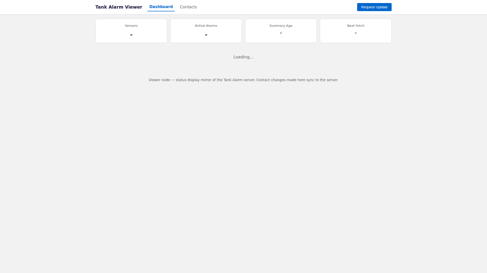

# Website Preview - TankAlarm 112025 Viewer

This document contains screenshots of the web interface served by the TankAlarm-112025-Viewer-BluesOpta.

## Dashboard
Read-only fleet telemetry dashboard laid out like the server dashboard: stat cards, an Active Alarms section, and one section per site with client status dots and sensor cards (level, Float Switch ON/OFF, faults, contents, 24 h change, VIN).

---
*Screenshots automatically generated by GitHub Actions*  
*Last updated: 2026-10-26 07:17:14 UTC*
